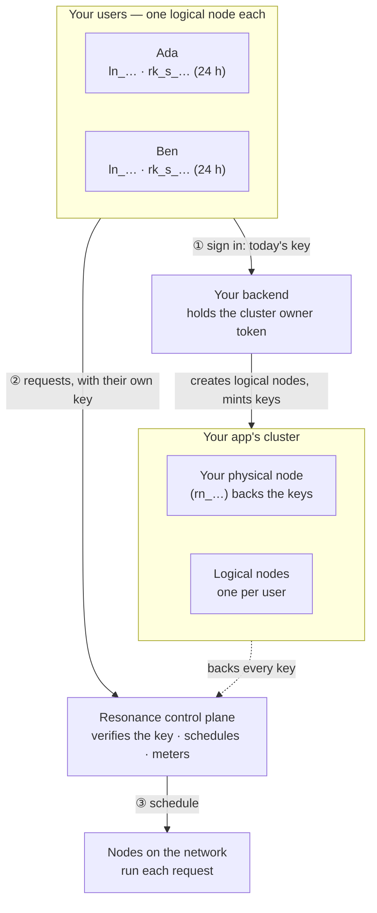

# Resonance sample apps

Eight complete apps built on the [Resonance](https://resonance.narsill.com) network, and the architecture that makes an app fully part of it: **every user becomes a logical node** with their own short-lived key, grouped in the app's cluster, backed by your physical node, metered and capped per person.

Each app is a real product with its own design — a CRM, a support desk, a handbook, an expense tool, a code reviewer, a localization studio, a data analyst and a hiring desk — and each talks to the network only through its public HTTP API: no SDK, no hidden service. Open any of them, click **Runs on Resonance**, and you see how it works, how it sits on the network, every request it made on a shared timeline, and the exact code behind each.

**Try them live:** [resonance.narsill.com/samples](https://resonance.narsill.com/samples)

| App | What it does | The pattern to copy |
|---|---|---|
| [**Kestrel** · Sales CRM](apps/crm/README.md) | Scores every deal at once; coaches, extracts call notes, sweeps stale deals | fan-out JSON scoring · extraction · streamed prose |
| [**Relay** · Support desk](apps/support/README.md) | Triages the whole inbox in parallel, finds incidents, replies in each customer's language | map → reduce → act |
| [**Folio** · Company handbook](apps/knowledge/README.md) | Answers from the handbook, citing the exact page; audits every page | retrieval without a vector database · verified quotes |
| [**Tally** · Expense reports](apps/expenses/README.md) | Reads receipt photos, checks them against policy, reviews the report | vision fan-out · policy in code |
| [**Lintel** · Code review](apps/review/README.md) | Reviews every file of a pull request in parallel, plus a security pass | two reviewers per file · reduce to a verdict |
| [**Parlance** · Localization](apps/localize/README.md) | Translates an app into eight languages at once, back-translates, checks | fan-out per language · checks in code |
| [**Quarry** · Data analyst](apps/data/README.md) | Answers questions about a table; data quality report | the model plans, code computes — rows never leave |
| [**Shortlist** · Hiring desk](apps/hiring/README.md) | Screens applicants blind, every score backed by a verified quote | blinding and evidence checks in code |

## Quick start

```bash
git clone https://github.com/narsill-oss/resonance-samples
cd resonance-samples
npm install
npm run dev
```

Open <http://localhost:5173/samples>, pick an app, and connect it: click **Runs on Resonance → Connection** and paste an API key. The quickest key is your own node's — run `resonance api-key` on a machine where the Resonance node is installed. The key stays in your browser and is sent only to the network.

That is enough to use every app. To see the architecture working for real — one logical node and one key per user — run the session server too:

```bash
RESONANCE_NODE_KEY=rk_… RESONANCE_NODE_ID=rn_… npm run server     # terminal 1
VITE_SESSION_URL=http://127.0.0.1:8787/session npm run dev         # terminal 2
```

Now **Runs on Resonance → Architecture → Signed in as** is real: switching user fetches that user's own logical node key from the server, and every call is metered to them. See [server/README.md](server/README.md).

## The architecture



The pieces, from the bottom up:

- **Physical node** — a machine running the Resonance node (`resonance`). It has an id (`rn_…`) and a key (`rk_…`). It is how you join the network; its key is the only secret your backend needs, and it never goes to a browser.
- **Cluster** — groups an app's users. You create one per app with your node's key and attach your physical node to it: a cluster with no physical node cannot mint working keys. Creating it returns an **owner token** (`ot_…`), the capability to manage it.
- **Logical node** — one per user (or per repository, per scheduled job — whatever you meter separately). It has no hardware. It is created in the cluster with the cluster's owner token and returns its own owner token.
- **Scoped key** — `GET /v1/logical-nodes/:id/api-key` returns a key for that logical node only, `rk_s_<logical node>.<cluster>.<expiry>.<signature>`, valid 24 hours. Your backend hands it to the signed-in user's browser, which calls the network directly with it.
- **The control plane** checks each key (signature, expiry, revocation, that the logical node is still in that cluster and running, that the cluster still has a physical node), schedules the request on a capable node of the network, and counts it on the caller's logical node.

What you get from this:

- **Per-user usage and budgets** — `GET /v1/logical-nodes/:id/usage` returns each user's requests and tokens; stop a logical node and its keys are refused until you start it again.
- **Instant offboarding** — delete a logical node and every key it was ever given stops working at once.
- **No shared secret in the browser** — a leaked user key is one user's, for at most a day.

The full walk-through, with the lifecycle of a user and every request: [docs/architecture.md](docs/architecture.md). To put your own app on the network step by step: [docs/integration-guide.md](docs/integration-guide.md).

## What every app shows

Every app carries the same developer panel (**Runs on Resonance**), whatever its own design:

- **How it works** — the calls the app makes, and why each is shaped that way.
- **Architecture** — the app on the network: its users as logical nodes, the cluster, its backend, where requests run; "signed in as" to tag calls per user and see per-user usage live; the code for each step (set up once, per user, call, usage and offboarding).
- **Requests** — every request on a timeline (bars that overlap ran side by side), the parallel speed-up, and each one as curl and as JavaScript.
- **Connection** — the key, the model and the tier.

And the same patterns, in different shapes: [docs/patterns.md](docs/patterns.md) — fan-out with bounded concurrency, map → reduce, JSON replies checked in code, streaming, retries, and what never to leave to a model.

## Layout

```
src/
  samples/          the eight apps, exactly as they run on resonance.narsill.com
    api.js          the whole network client: fetch, streaming, retries, request log
    network.jsx     the developer panel and shared hooks
    Architecture.jsx, archs.js   the Architecture tab and each app's architecture
    Crm.jsx …       one file per app, with its stylesheet
  site/lib/         the two site helpers the apps use (page title, links)
  main.jsx, Home.jsx
server/
  server.mjs        the session server: clusters, logical nodes, keys, usage, caps, offboarding
apps/<app>/         one README per app: how it works, its architecture, its requests
docs/               architecture, integration guide, patterns, API reference
```

## Documentation

- [Architecture](docs/architecture.md) — physical nodes, clusters, logical nodes and keys, and a user's lifecycle.
- [Integration guide](docs/integration-guide.md) — put your own app on the network, step by step.
- [Patterns](docs/patterns.md) — the techniques the samples share.
- [API reference](docs/api-reference.md) — every endpoint the samples and the session server use.
- [Resonance docs](https://docs-resonance.narsill.com) — the network, nodes, models, protocols and the SDK.

## License

Apache 2.0 — see [LICENSE](LICENSE). The sample data (companies, people, tickets, CVs) is made up.
