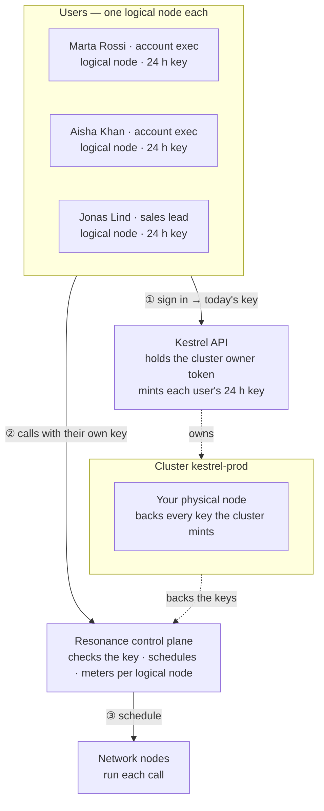

# Kestrel — Sales CRM

> Scores every deal in your pipeline at once.

Kestrel is one of the eight [Resonance sample apps](../../README.md). It is a complete product — its own design, sample data, work kept in the browser — whose intelligence is a handful of calls to the Resonance network.

- **Source:** [`src/samples/Crm.jsx`](../../src/samples/Crm.jsx) · styles [`src/samples/crm.css`](../../src/samples/crm.css)
- **Live:** [resonance.narsill.com/samples/crm](https://resonance.narsill.com/samples/crm)
- **Runs locally:** `npm run dev`, then open `http://localhost:5173/samples/crm`
- **Model:** any text model (tag `text-generation`, e.g. GLM-4.7-Flash)

## How it works

Kestrel is an ordinary CRM: the intelligence is six kinds of call to `POST /v1/chat/completions`.

- **Rescore pipeline** — one JSON request per deal, four at a time. Watch the Requests tab: the bars overlap because different nodes serve them side by side.
- **Deal coach** — the same scoring call for one deal, rendered as probability, risks and a next action.
- **Call notes → fields** — extraction: free text in, typed JSON out (budget, decision makers, objections…), then written back to the deal.
- **Stale sweep** — every deal quiet for a week or more gets its own follow-up draft, written in parallel from that deal's notes; logging one resets its last touch.
- **Follow-up** and **Forecast brief** — streamed prose ("stream": true) that you can stop half-way.

#### Make it yours

Add deals by hand or import a CSV (company, contact, role, value, stage, notes); everything is kept in this browser. In production, replace that with your CRM's API and keep the prompts. Give the server that runs it a logical node key, so its usage is metered on its own.

## How it sits on the network

Each rep is a logical node, so the forecast a manager runs and the follow-ups a rep drafts are metered and capped per person. The CRM server never hands out its own key: it mints a 24-hour key for the rep who is signed in.



| | |
|---|---|
| **Who is a logical node** | each sales rep — in the demo: “Marta Rossi · account exec”, “Aisha Khan · account exec”, “Jonas Lind · sales lead” |
| **Cluster** | `kestrel-prod`, with your physical node attached |
| **Backend** | Kestrel API: holds the cluster's owner token, creates a logical node per sales rep, and hands each signed-in sales rep their own 24-hour key |
| **Metering** | every call is counted on the caller's logical node: `GET /v1/logical-nodes/:id/usage` |

### The calls it makes

| Call | Shape |
|---|---|
| Rescore pipeline | fan-out · 1 JSON call per deal · 4 at a time |
| Deal coach · call notes | 1 JSON call per action |
| Follow-up · forecast · stale sweep | streamed prose / fan-out drafts |

> Cap each rep, e.g. 3 000 requests a month: read their logical node's usage before minting the next key, and stop the node when they leave the team.

### One of its requests

What a signed-in sales rep's browser sends — with their own `rk_s_…` key, never your node key:

```bash
curl https://net.narsill.io/v1/chat/completions \
  -H "Authorization: Bearer $USER_KEY" \
  -H "Content-Type: application/json" \
  -d '{"model": "GLM-4.7-Flash", "messages": [{"role": "system", "content": "Score this deal. Reply ONLY with JSON: {\"win_probability\": 0-100, \"risks\": [string], \"next_action\": string}."}, {"role": "user", "content": "Brightmills · €48 000 · Negotiation · last touch 9 days ago"}], "max_tokens": 400}'
```

In the app, open **Runs on Resonance → Requests** to see every real request it made, as curl and as JavaScript.

## Try the architecture for real

1. Start the session server: `RESONANCE_NODE_KEY=rk_… RESONANCE_NODE_ID=rn_… npm run server` (see [server/](../../server/README.md)).
2. Start the app with `VITE_SESSION_URL=http://127.0.0.1:8787/session npm run dev`.
3. Open **Runs on Resonance → Architecture** and switch **Signed in as**: the server creates the `kestrel-prod` cluster on first use, a logical node for that sales rep, and returns their key. Every call from then on is metered to them — `curl http://127.0.0.1:8787/usage` shows it.

## Make it your own

- Keep the prompts (they are constants at the top of [`Crm.jsx`](../../src/samples/Crm.jsx)) and the JSON shapes; replace the sample data with your own source.
- Keep the parts that must be exact in code — the samples never let a model decide a number, a policy or a verdict on its own.
- Move the provisioning in [`server/server.mjs`](../../server/server.mjs) into your backend, behind your own sign-in.
