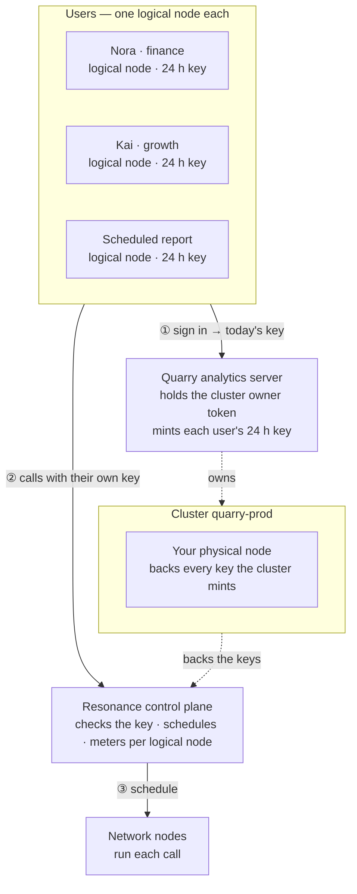

# Quarry — Data analyst

> Answers questions about a table in plain words.

Quarry is one of the eight [Resonance sample apps](../../README.md). It is a complete product — its own design, sample data, work kept in the browser — whose intelligence is a handful of calls to the Resonance network.

- **Source:** [`src/samples/Quarry.jsx`](../../src/samples/Quarry.jsx) · styles [`src/samples/quarry.css`](../../src/samples/quarry.css)
- **Live:** [resonance.narsill.com/samples/data](https://resonance.narsill.com/samples/data)
- **Runs locally:** `npm run dev`, then open `http://localhost:5173/samples/data`
- **Model:** any text model (tag `text-generation`, e.g. GLM-4.7-Flash)

## How it works

Quarry splits the work so numbers are never made up:

- **Plan** — the model gets the question and the table's schema (column types, ranges, top values, five example rows) — never the rows — and replies with a query plan in JSON.
- **Compute** — a small engine in this page validates the plan and runs it on every row: filters, time buckets, groups, sums, rates, medians. An invalid plan goes back to the model once with the error, so it can fix it.
- **Narrate** — a second call gets only the computed result and writes the answer, citing those numbers.
- **Quality** — the page checks every row for empty cells, extreme outliers, inconsistent spellings, future dates and duplicates; one call sees only the schema and those findings and says what to fix first.
- **Explore** — six of these chains (trend, breakdown, change, anomaly, mix, ranking) run side by side, then one streamed call turns the six results into a briefing.

#### Your data

Upload a CSV: types are inferred in the page. Only the schema, five example rows and the computed results are sent to the network.

#### Make it yours

Point the engine at your warehouse instead: have the model write the same JSON plan, compile it to SQL with a whitelist of tables and columns, and keep the narrate step.

## How it sits on the network

Rows never leave the analyst's machine: only the schema, five sample rows and computed results do. Each analyst — and each scheduled report — is a logical node, so the weekly report's cost is separate from ad-hoc questions.



| | |
|---|---|
| **Who is a logical node** | each analyst — in the demo: “Nora · finance”, “Kai · growth”, “Scheduled report” |
| **Cluster** | `quarry-prod`, with your physical node attached |
| **Backend** | Quarry analytics server: holds the cluster's owner token, creates a logical node per analyst, and hands each signed-in analyst their own 24-hour key |
| **Metering** | every call is counted on the caller's logical node: `GET /v1/logical-nodes/:id/usage` |

### The calls it makes

| Call | Shape |
|---|---|
| Plan | 1 JSON call · sees only the schema, never the rows |
| Narrate · explore | 6 chains side by side, then 1 streamed briefing |
| Data quality | code profiles the columns, 1 call explains |

> Scheduled reports run from a server: give them their own logical node and a key minted per run.

### One of its requests

What a signed-in analyst's browser sends — with their own `rk_s_…` key, never your node key:

```bash
curl https://net.narsill.io/v1/chat/completions \
  -H "Authorization: Bearer $USER_KEY" \
  -H "Content-Type: application/json" \
  -d '{"model": "GLM-4.7-Flash", "messages": [{"role": "system", "content": "Plan a query for this question. Reply ONLY with JSON {\"filters\", \"group_by\", \"metric\"}."}, {"role": "user", "content": "Schema: date (date), region (text), revenue (number)…\nQuestion: which region grew fastest last quarter?"}], "max_tokens": 400}'
```

In the app, open **Runs on Resonance → Requests** to see every real request it made, as curl and as JavaScript.

## Try the architecture for real

1. Start the session server: `RESONANCE_NODE_KEY=rk_… RESONANCE_NODE_ID=rn_… npm run server` (see [server/](../../server/README.md)).
2. Start the app with `VITE_SESSION_URL=http://127.0.0.1:8787/session npm run dev`.
3. Open **Runs on Resonance → Architecture** and switch **Signed in as**: the server creates the `quarry-prod` cluster on first use, a logical node for that analyst, and returns their key. Every call from then on is metered to them — `curl http://127.0.0.1:8787/usage` shows it.

## Make it your own

- Keep the prompts (they are constants at the top of [`Quarry.jsx`](../../src/samples/Quarry.jsx)) and the JSON shapes; replace the sample data with your own source.
- Keep the parts that must be exact in code — the samples never let a model decide a number, a policy or a verdict on its own.
- Move the provisioning in [`server/server.mjs`](../../server/server.mjs) into your backend, behind your own sign-in.
