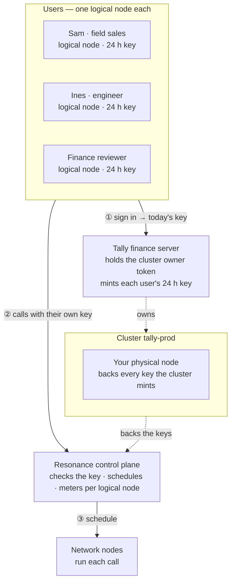

# Tally — Expense reports

> Reads receipt photos and checks them against policy.

Tally is one of the eight [Resonance sample apps](../../README.md). It is a complete product — its own design, sample data, work kept in the browser — whose intelligence is a handful of calls to the Resonance network.

- **Source:** [`src/samples/Expenses.jsx`](../../src/samples/Expenses.jsx) · styles [`src/samples/tally.css`](../../src/samples/tally.css)
- **Live:** [resonance.narsill.com/samples/expenses](https://resonance.narsill.com/samples/expenses)
- **Runs locally:** `npm run dev`, then open `http://localhost:5173/samples/expenses`
- **Model:** a vision model (tag `vision`, e.g. Qwen3-VL-235B)

## How it works

Tally mixes AI where it shines with plain code where rules must be exact:

- **Scan all** — one vision request per receipt, five at a time: the photo goes as an `image_url` data URL in the message, the reply is typed JSON (merchant, date, currency, total, items, alcohol flags).
- **Policy** — no model involved: hotel caps per night, the meal cap, alcohol, currency conversion and duplicate detection run in JavaScript, so the numbers are deterministic and auditable.
- **Finance review** — code finds patterns across the report (split bills, weekend spending, round totals); one call reads only those and the receipts' fields, never the photos, and tells the reviewer what to ask.
- **Report note** — one streamed request turns the checked report into a note for the approver.

#### Make it yours

Swap the drawn receipts for uploads from your app, keep the JSON schema, and put the policy in your own code. Vision requests are larger: cap concurrency and downscale photos first (Tally keeps them under 1100 px).

## How it sits on the network

Receipt photos are personal data: each employee's scans are metered to their own logical node, and the finance reviewer's anomaly pass to theirs. Vision calls are the heavy ones — downscale before sending and keep concurrency low.



| | |
|---|---|
| **Who is a logical node** | each employee filing expenses — in the demo: “Sam · field sales”, “Ines · engineer”, “Finance reviewer” |
| **Cluster** | `tally-prod`, with your physical node attached |
| **Backend** | Tally finance server: holds the cluster's owner token, creates a logical node per employee filing expenses, and hands each signed-in employee filing expenses their own 24-hour key |
| **Metering** | every call is counted on the caller's logical node: `GET /v1/logical-nodes/:id/usage` |

### The calls it makes

| Call | Shape |
|---|---|
| Scan receipts | fan-out · 1 vision call per photo · 5 at a time |
| Policy · anomalies | plain code, then 1 JSON call over the report |
| Report note | 1 streamed call |

> Run vision on a vision-tagged model, and send receipts with "tier": "paid" so they are read only by verified paid nodes.

### One of its requests

What a signed-in employee filing expenses's browser sends — with their own `rk_s_…` key, never your node key:

```bash
curl https://net.narsill.io/v1/chat/completions \
  -H "Authorization: Bearer $USER_KEY" \
  -H "Content-Type: application/json" \
  -d '{"model": "Qwen3-VL-235B", "messages": [{"role": "system", "content": "Read this receipt. Reply ONLY with JSON: {\"merchant\", \"date\", \"currency\", \"total\", \"items\"}."}, {"role": "user", "content": "[image_url: receipt.jpg]"}], "max_tokens": 400}'
```

In the app, open **Runs on Resonance → Requests** to see every real request it made, as curl and as JavaScript.

## Try the architecture for real

1. Start the session server: `RESONANCE_NODE_KEY=rk_… RESONANCE_NODE_ID=rn_… npm run server` (see [server/](../../server/README.md)).
2. Start the app with `VITE_SESSION_URL=http://127.0.0.1:8787/session npm run dev`.
3. Open **Runs on Resonance → Architecture** and switch **Signed in as**: the server creates the `tally-prod` cluster on first use, a logical node for that employee filing expenses, and returns their key. Every call from then on is metered to them — `curl http://127.0.0.1:8787/usage` shows it.

## Make it your own

- Keep the prompts (they are constants at the top of [`Expenses.jsx`](../../src/samples/Expenses.jsx)) and the JSON shapes; replace the sample data with your own source.
- Keep the parts that must be exact in code — the samples never let a model decide a number, a policy or a verdict on its own.
- Move the provisioning in [`server/server.mjs`](../../server/server.mjs) into your backend, behind your own sign-in.
