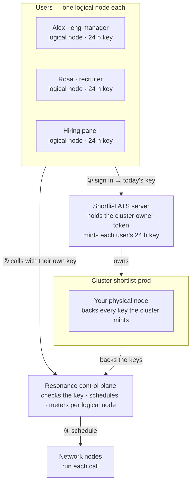

# Shortlist — Hiring desk

> Screens applicants blind, every score backed by evidence.

Shortlist is one of the eight [Resonance sample apps](../../README.md). It is a complete product — its own design, sample data, work kept in the browser — whose intelligence is a handful of calls to the Resonance network.

- **Source:** [`src/samples/Hiring.jsx`](../../src/samples/Hiring.jsx) · styles [`src/samples/shortlist.css`](../../src/samples/shortlist.css)
- **Live:** [resonance.narsill.com/samples/hiring](https://resonance.narsill.com/samples/hiring)
- **Runs locally:** `npm run dev`, then open `http://localhost:5173/samples/hiring`
- **Model:** any text model (tag `text-generation`, e.g. GLM-4.7-Flash)

## How it works

Screening fans out by applicant; code guards the parts that must be fair and exact:

- **Blind** — before anything is sent, code strips names, contact details, links, age, family status and gendered pronouns. Toggle Blind off to see the difference.
- **Rubric from a job ad** — paste a posting and one call drafts the criteria, what evidence shows each, and the must-haves; code makes the weights add up to 100.
- **Screen** — one request per CV, five at a time: a 0–4 score per criterion and each must-have, each with a verbatim quote as evidence. JSON out.
- **Verify** — code checks every quote is really in the CV. A score without real evidence counts as zero and is flagged, so an invented claim can't lift anyone.
- **Weigh** — the rubric weights are applied in code; a failed must-have is a knockout, shown, never hidden.
- **Act** — compare 2–3 people in one call, stream an interview kit aimed at the gaps, and draft emails where the name is filled in locally.

#### Limits

Removing obvious signals reduces bias; it doesn't remove it. Treat the score as a reading aid for people, not a decision.

#### Make it yours

Pull applicants from your ATS webhook, keep the rubric in your repo, and store only the scores and quotes.

## How it sits on the network

CVs are personal data: blinding happens in code before anything is sent, and each hiring manager is a logical node, so who screened how many applicants is on record. Send CVs with "tier": "paid" to keep them off the open network.



| | |
|---|---|
| **Who is a logical node** | each hiring manager — in the demo: “Alex · eng manager”, “Rosa · recruiter”, “Hiring panel” |
| **Cluster** | `shortlist-prod`, with your physical node attached |
| **Backend** | Shortlist ATS server: holds the cluster's owner token, creates a logical node per hiring manager, and hands each signed-in hiring manager their own 24-hour key |
| **Metering** | every call is counted on the caller's logical node: `GET /v1/logical-nodes/:id/usage` |

### The calls it makes

| Call | Shape |
|---|---|
| Rubric from a job ad | 1 JSON call |
| Screen | fan-out · 1 JSON call per CV · 5 at a time |
| Compare · interview kit | 1 call / 1 streamed call |

> Keep the per-manager keys short-lived and revoke them when a role closes; store only scores and quotes, never the model's raw replies.

### One of its requests

What a signed-in hiring manager's browser sends — with their own `rk_s_…` key, never your node key:

```bash
curl https://net.narsill.io/v1/chat/completions \
  -H "Authorization: Bearer $USER_KEY" \
  -H "Content-Type: application/json" \
  -d '{"model": "GLM-4.7-Flash", "messages": [{"role": "system", "content": "Score this CV against the rubric. Reply ONLY with JSON {\"criteria\": [{\"name\", \"score\", \"quote\"}]}."}, {"role": "user", "content": "Rubric: …\n\nCV (blinded): …"}], "max_tokens": 400}'
```

In the app, open **Runs on Resonance → Requests** to see every real request it made, as curl and as JavaScript.

## Try the architecture for real

1. Start the session server: `RESONANCE_NODE_KEY=rk_… RESONANCE_NODE_ID=rn_… npm run server` (see [server/](../../server/README.md)).
2. Start the app with `VITE_SESSION_URL=http://127.0.0.1:8787/session npm run dev`.
3. Open **Runs on Resonance → Architecture** and switch **Signed in as**: the server creates the `shortlist-prod` cluster on first use, a logical node for that hiring manager, and returns their key. Every call from then on is metered to them — `curl http://127.0.0.1:8787/usage` shows it.

## Make it your own

- Keep the prompts (they are constants at the top of [`Hiring.jsx`](../../src/samples/Hiring.jsx)) and the JSON shapes; replace the sample data with your own source.
- Keep the parts that must be exact in code — the samples never let a model decide a number, a policy or a verdict on its own.
- Move the provisioning in [`server/server.mjs`](../../server/server.mjs) into your backend, behind your own sign-in.
