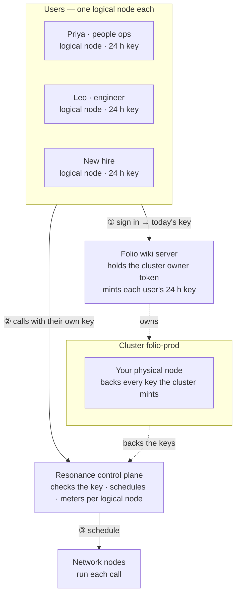

# Folio — Company handbook

> Answers from your handbook, citing the exact page.

Folio is one of the eight [Resonance sample apps](../../README.md). It is a complete product — its own design, sample data, work kept in the browser — whose intelligence is a handful of calls to the Resonance network.

- **Source:** [`src/samples/Knowledge.jsx`](../../src/samples/Knowledge.jsx) · styles [`src/samples/knowledge.css`](../../src/samples/knowledge.css)
- **Live:** [resonance.narsill.com/samples/knowledge](https://resonance.narsill.com/samples/knowledge)
- **Runs locally:** `npm run dev`, then open `http://localhost:5173/samples/knowledge`
- **Model:** any text model (tag `text-generation`, e.g. GLM-4.7-Flash)

## How it works

Folio is retrieval without a vector database — a fan-out that the network makes cheap:

- **Rewrite** (follow-ups only) — one JSON call turns "and in Spain?" into a full question.
- **Read** — one request per page, six at a time: relevance 0-3 plus the exact sentence. The spines light up as each page comes back.
- **Answer** — one streamed call that sees only the matching quotes and must cite them as [1], [2]. Click a citation to open the page with the sentence highlighted.
- **Audit** — every page gets its own reviewer at once, flagging unclear, outdated or risky sentences; a flag is kept only if its sentence is really on the page, and an accepted rewrite changes the page.
- **Fill the gap** — if nothing matches, draft the missing page in the handbook's voice and add it; the next question reads it too.

#### When to switch to embeddings

Up to a few hundred pages, reading everything in parallel is simple and accurate. Beyond that, pre-filter with a keyword or embedding search and keep this read-then-answer step for the top pages.

## How it sits on the network

Every employee asking questions is a logical node: heavy readers don't eat someone else's budget, and you can tell which teams rely on the handbook. The handbook itself never leaves your server except as the pages each question reads.



| | |
|---|---|
| **Who is a logical node** | each employee — in the demo: “Priya · people ops”, “Leo · engineer”, “New hire” |
| **Cluster** | `folio-prod`, with your physical node attached |
| **Backend** | Folio wiki server: holds the cluster's owner token, creates a logical node per employee, and hands each signed-in employee their own 24-hour key |
| **Metering** | every call is counted on the caller's logical node: `GET /v1/logical-nodes/:id/usage` |

### The calls it makes

| Call | Shape |
|---|---|
| Read | fan-out · 1 JSON call per page · 6 at a time |
| Answer | 1 streamed call over the matching quotes |
| Audit · fill the gap | fan-out per page / 1 drafted page |

> For confidential handbooks, send the calls with "tier": "paid": they then run only on verified paid nodes, never on the open network.

### One of its requests

What a signed-in employee's browser sends — with their own `rk_s_…` key, never your node key:

```bash
curl https://net.narsill.io/v1/chat/completions \
  -H "Authorization: Bearer $USER_KEY" \
  -H "Content-Type: application/json" \
  -d '{"model": "GLM-4.7-Flash", "messages": [{"role": "system", "content": "Does this page answer the question? Reply ONLY with JSON: {\"relevance\": 0-3, \"quote\": string}."}, {"role": "user", "content": "Question: how many days can I work abroad?\n\nPage: Remote work policy…"}], "max_tokens": 400}'
```

In the app, open **Runs on Resonance → Requests** to see every real request it made, as curl and as JavaScript.

## Try the architecture for real

1. Start the session server: `RESONANCE_NODE_KEY=rk_… RESONANCE_NODE_ID=rn_… npm run server` (see [server/](../../server/README.md)).
2. Start the app with `VITE_SESSION_URL=http://127.0.0.1:8787/session npm run dev`.
3. Open **Runs on Resonance → Architecture** and switch **Signed in as**: the server creates the `folio-prod` cluster on first use, a logical node for that employee, and returns their key. Every call from then on is metered to them — `curl http://127.0.0.1:8787/usage` shows it.

## Make it your own

- Keep the prompts (they are constants at the top of [`Knowledge.jsx`](../../src/samples/Knowledge.jsx)) and the JSON shapes; replace the sample data with your own source.
- Keep the parts that must be exact in code — the samples never let a model decide a number, a policy or a verdict on its own.
- Move the provisioning in [`server/server.mjs`](../../server/server.mjs) into your backend, behind your own sign-in.
