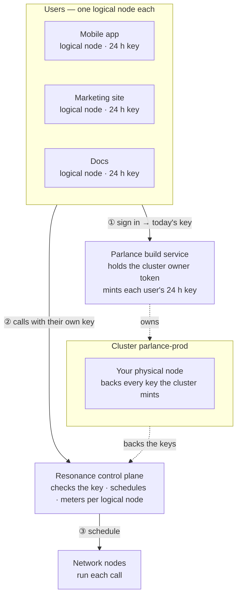

# Parlance — Localization studio

> Translates your app into eight languages at once.

Parlance is one of the eight [Resonance sample apps](../../README.md). It is a complete product — its own design, sample data, work kept in the browser — whose intelligence is a handful of calls to the Resonance network.

- **Source:** [`src/samples/Localize.jsx`](../../src/samples/Localize.jsx) · styles [`src/samples/parlance.css`](../../src/samples/parlance.css)
- **Live:** [resonance.narsill.com/samples/localize](https://resonance.narsill.com/samples/localize)
- **Runs locally:** `npm run dev`, then open `http://localhost:5173/samples/localize`
- **Model:** any text model (tag `text-generation`, e.g. GLM-4.7-Flash)

## How it works

Localization fans out naturally — by language:

- **Translate** — one request per language carrying every string (with context and length limits), all languages at once. JSON in, JSON out.
- **Review** — another request per language, also side by side: each back-translates its language and scores every string.
- **Glossary** — one call reads every source string and proposes the terms that must stay untranslated; code keeps only terms that really appear in your strings.
- **Check** — plain code verifies what must never be left to a model: placeholders, length limits, glossary terms, emoji.
- **Fix** — retranslate one cell with a note ("shorter", "less formal"), or edit it by hand; the checks rerun instantly.

#### Your own app

Strings → Import en.json takes a flat or nested i18n file. Add any language, set your glossary, then export one JSON per language. Everything stays in this browser.

#### Make it yours

Run the same calls in CI on every new string, fail the build on red cells, and open a PR with the rest. 16 requests for 8 languages take about as long as 2.

## How it sits on the network

Each product being localized is a logical node, so the docs team's 40 languages don't share a budget with the app's 8. The checks that must be exact — placeholders, lengths, glossary — are code, not model calls.



| | |
|---|---|
| **Who is a logical node** | each project — in the demo: “Mobile app”, “Marketing site”, “Docs” |
| **Cluster** | `parlance-prod`, with your physical node attached |
| **Backend** | Parlance build service: holds the cluster's owner token, creates a logical node per project, and hands each signed-in project their own 24-hour key |
| **Metering** | every call is counted on the caller's logical node: `GET /v1/logical-nodes/:id/usage` |

### The calls it makes

| Call | Shape |
|---|---|
| Translate | fan-out · 1 JSON call per language · 8 at once |
| Review | fan-out · back-translation per language |
| Glossary · fix a cell | 1 JSON call each |

> When many languages fan out at once and the network is busy, requests wait for a free node instead of failing; the client still retries a few times with jitter.

### One of its requests

What a signed-in project's browser sends — with their own `rk_s_…` key, never your node key:

```bash
curl https://net.narsill.io/v1/chat/completions \
  -H "Authorization: Bearer $USER_KEY" \
  -H "Content-Type: application/json" \
  -d '{"model": "GLM-4.7-Flash", "messages": [{"role": "system", "content": "Translate these UI strings to German. Reply ONLY with JSON {key: translation}. Keep {placeholders}."}, {"role": "user", "content": "[{\"key\": \"cart.title\", \"source\": \"Your cart ({count})\", \"max\": 24}]"}], "max_tokens": 400}'
```

In the app, open **Runs on Resonance → Requests** to see every real request it made, as curl and as JavaScript.

## Try the architecture for real

1. Start the session server: `RESONANCE_NODE_KEY=rk_… RESONANCE_NODE_ID=rn_… npm run server` (see [server/](../../server/README.md)).
2. Start the app with `VITE_SESSION_URL=http://127.0.0.1:8787/session npm run dev`.
3. Open **Runs on Resonance → Architecture** and switch **Signed in as**: the server creates the `parlance-prod` cluster on first use, a logical node for that project, and returns their key. Every call from then on is metered to them — `curl http://127.0.0.1:8787/usage` shows it.

## Make it your own

- Keep the prompts (they are constants at the top of [`Localize.jsx`](../../src/samples/Localize.jsx)) and the JSON shapes; replace the sample data with your own source.
- Keep the parts that must be exact in code — the samples never let a model decide a number, a policy or a verdict on its own.
- Move the provisioning in [`server/server.mjs`](../../server/server.mjs) into your backend, behind your own sign-in.
