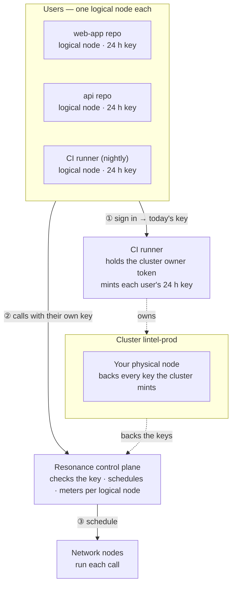

# Lintel — Code review

> Reviews every file of a pull request in parallel.

Lintel is one of the eight [Resonance sample apps](../../README.md). It is a complete product — its own design, sample data, work kept in the browser — whose intelligence is a handful of calls to the Resonance network.

- **Source:** [`src/samples/Review.jsx`](../../src/samples/Review.jsx) · styles [`src/samples/lintel.css`](../../src/samples/lintel.css)
- **Live:** [resonance.narsill.com/samples/review](https://resonance.narsill.com/samples/review)
- **Runs locally:** `npm run dev`, then open `http://localhost:5173/samples/review`
- **Model:** a coding model (tag `coding`, e.g. Qwen3-Coder-480B)

## How it works

Lintel reviews like a team would — each file by its own reviewer, then a lead decides:

- **Review** — one request per file, all at once, on a coding model. Each returns findings as JSON tied to a line number, so they render inline in the diff.
- **Security pass** — a second reviewer per file, at the same time as the first, looking only for what an attacker would use. Its findings are tagged 🔒 in the diff.
- **Verdict** — one request reads every finding and returns approve / comment / request changes, a 1–5 risk and the must-fix list.
- **Write the fix** and **Generate tests** — streamed on demand, with the file's diff as context.

#### Make it yours

Call it from CI with the PR's diff (git diff origin/main...), post the findings as review comments, and give the CI runner a logical node key so review traffic is metered on its own.

## How it sits on the network

Here the "users" are repositories: each one is a logical node, so review traffic per repo is visible and a noisy monorepo can be capped. CI holds the cluster owner token as a secret and mints a key per pipeline run.



| | |
|---|---|
| **Who is a logical node** | each repository — in the demo: “web-app repo”, “api repo”, “CI runner (nightly)” |
| **Cluster** | `lintel-prod`, with your physical node attached |
| **Backend** | CI runner: holds the cluster's owner token, creates a logical node per repository, and hands each signed-in repository their own 24-hour key |
| **Metering** | every call is counted on the caller's logical node: `GET /v1/logical-nodes/:id/usage` |

### The calls it makes

| Call | Shape |
|---|---|
| Review · security pass | fan-out · 1 call per file, on a coding model |
| Verdict | reduce · 1 call over every finding |
| Fix · tests | streamed on demand |

> Mint keys that live one CI job: the key is useless once the job ends, even if a log leaks it.

### One of its requests

What a signed-in repository's browser sends — with their own `rk_s_…` key, never your node key:

```bash
curl https://net.narsill.io/v1/chat/completions \
  -H "Authorization: Bearer $USER_KEY" \
  -H "Content-Type: application/json" \
  -d '{"model": "Qwen3-Coder-480B", "messages": [{"role": "system", "content": "Review this file'\''s diff. Reply ONLY with JSON: {\"findings\": [{\"line\", \"severity\", \"message\"}]}."}, {"role": "user", "content": "src/auth/session.ts\n@@ -12,7 +12,9 @@ …"}], "max_tokens": 400}'
```

In the app, open **Runs on Resonance → Requests** to see every real request it made, as curl and as JavaScript.

## Try the architecture for real

1. Start the session server: `RESONANCE_NODE_KEY=rk_… RESONANCE_NODE_ID=rn_… npm run server` (see [server/](../../server/README.md)).
2. Start the app with `VITE_SESSION_URL=http://127.0.0.1:8787/session npm run dev`.
3. Open **Runs on Resonance → Architecture** and switch **Signed in as**: the server creates the `lintel-prod` cluster on first use, a logical node for that repository, and returns their key. Every call from then on is metered to them — `curl http://127.0.0.1:8787/usage` shows it.

## Make it your own

- Keep the prompts (they are constants at the top of [`Review.jsx`](../../src/samples/Review.jsx)) and the JSON shapes; replace the sample data with your own source.
- Keep the parts that must be exact in code — the samples never let a model decide a number, a policy or a verdict on its own.
- Move the provisioning in [`server/server.mjs`](../../server/server.mjs) into your backend, behind your own sign-in.
