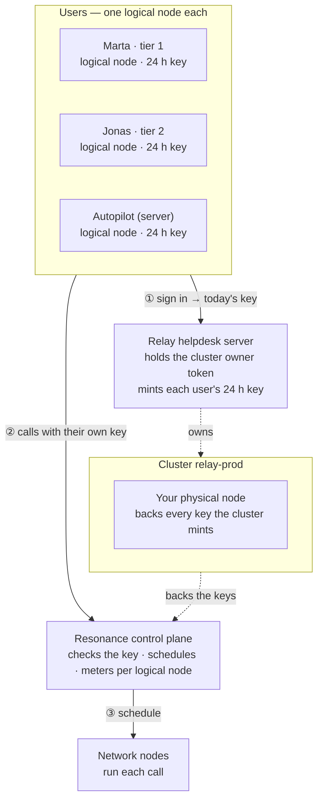

# Relay — Support desk

> Triages the whole inbox in parallel, in any language.

Relay is one of the eight [Resonance sample apps](../../README.md). It is a complete product — its own design, sample data, work kept in the browser — whose intelligence is a handful of calls to the Resonance network.

- **Source:** [`src/samples/Support.jsx`](../../src/samples/Support.jsx) · styles [`src/samples/support.css`](../../src/samples/support.css)
- **Live:** [resonance.narsill.com/samples/support](https://resonance.narsill.com/samples/support)
- **Runs locally:** `npm run dev`, then open `http://localhost:5173/samples/support`
- **Model:** any text model (tag `text-generation`, e.g. GLM-4.7-Flash)

## How it works

Relay's autopilot is a small pipeline on `POST /v1/chat/completions`:

- **Map** — one triage request per ticket, five at a time, each returning JSON (category, priority, sentiment, language, summary). They run side by side on the network.
- **Reduce** — one request reads every triage summary and groups tickets that share a cause into incidents. Three customers writing in three languages about "invalid assertion" become one SSO incident.
- **Reply to all affected** — from an incident, one reply per affected ticket, each in that customer's language, all drafted at once.
- **Act** — streamed translation, a reply drafted in the customer's own language that knows about the incident, and a status-page update.

#### Keyboard

`j` / `k` move · `r` draft a reply · `e` resolve

#### Make it yours

Point TICKETS at your helpdesk API (Zendesk, Front, your own inbox) and run the triage on a schedule from a server holding a logical node key.

## How it sits on the network

Agents get their own logical nodes; the autopilot that triages new tickets on a schedule is a logical node too, so you can see — and cap — what the automation costs apart from the people.



| | |
|---|---|
| **Who is a logical node** | each support agent — in the demo: “Marta · tier 1”, “Jonas · tier 2”, “Autopilot (server)” |
| **Cluster** | `relay-prod`, with your physical node attached |
| **Backend** | Relay helpdesk server: holds the cluster's owner token, creates a logical node per support agent, and hands each signed-in support agent their own 24-hour key |
| **Metering** | every call is counted on the caller's logical node: `GET /v1/logical-nodes/:id/usage` |

### The calls it makes

| Call | Shape |
|---|---|
| Triage | fan-out · 1 JSON call per ticket · 5 at a time |
| Incidents | reduce · 1 call over every triage |
| Replies · translation · incident replies | streamed, in the customer's language |

> Give the autopilot its own budget and stop its logical node to pause automation without touching the agents.

### One of its requests

What a signed-in support agent's browser sends — with their own `rk_s_…` key, never your node key:

```bash
curl https://net.narsill.io/v1/chat/completions \
  -H "Authorization: Bearer $USER_KEY" \
  -H "Content-Type: application/json" \
  -d '{"model": "GLM-4.7-Flash", "messages": [{"role": "system", "content": "You triage support tickets. Reply ONLY with JSON: {\"category\", \"priority\", \"language\", \"summary\"}."}, {"role": "user", "content": "R-2043 · Cannot log in — SSO broken · None of our 40 users can sign in…"}], "max_tokens": 400}'
```

In the app, open **Runs on Resonance → Requests** to see every real request it made, as curl and as JavaScript.

## Try the architecture for real

1. Start the session server: `RESONANCE_NODE_KEY=rk_… RESONANCE_NODE_ID=rn_… npm run server` (see [server/](../../server/README.md)).
2. Start the app with `VITE_SESSION_URL=http://127.0.0.1:8787/session npm run dev`.
3. Open **Runs on Resonance → Architecture** and switch **Signed in as**: the server creates the `relay-prod` cluster on first use, a logical node for that support agent, and returns their key. Every call from then on is metered to them — `curl http://127.0.0.1:8787/usage` shows it.

## Make it your own

- Keep the prompts (they are constants at the top of [`Support.jsx`](../../src/samples/Support.jsx)) and the JSON shapes; replace the sample data with your own source.
- Keep the parts that must be exact in code — the samples never let a model decide a number, a policy or a verdict on its own.
- Move the provisioning in [`server/server.mjs`](../../server/server.mjs) into your backend, behind your own sign-in.
