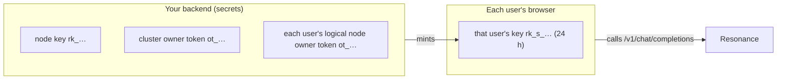
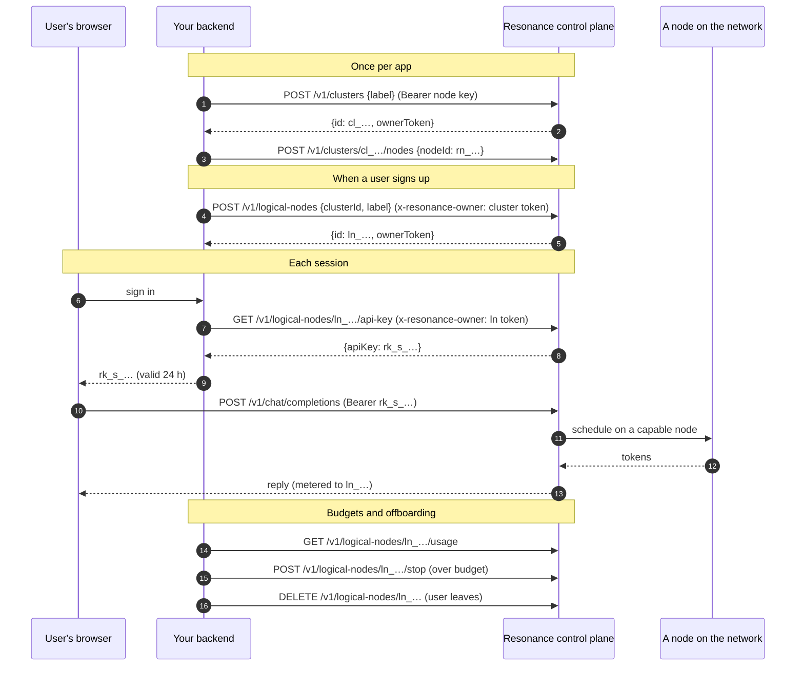

# Architecture: an app that is part of the network

This is how each sample app — and any app you build the same way — sits on Resonance. The short version: **your app has a cluster, every user is a logical node in it, and every user calls the network with their own key**, minted by your backend for one day at a time.

## The objects

| Object | Id | What it is | Created with |
|---|---|---|---|
| Physical node | `rn_…` | A machine running the Resonance node. Joins the network; its key `rk_…` (`resonance api-key`) is your backend's one secret. | `resonance` (the installer links it to your account) |
| Cluster | `cl_…` | One per app. Groups the app's logical nodes and inherits the key of the physical node attached to it. | `POST /v1/clusters` with the node's key |
| Logical node | `ln_…` | One per user (or per repository, scheduled job, project — whatever you want to see and cap separately). No hardware; it only consumes inference, through its cluster. | `POST /v1/logical-nodes` with the cluster's owner token |
| Scoped key | `rk_s_…` | One logical node's key, valid 24 hours: `rk_s_<ln>.<cluster>.<expiry ms>.<signature>`. | `GET /v1/logical-nodes/:id/api-key` with the logical node's owner token |
| Owner token | `ot_…` | The capability to manage a cluster or logical node, returned once when you create it. Keep it on your server. | returned by the create calls |

## Who holds what

- The **node key** and the **owner tokens** never leave your backend.
- The browser only ever holds its own user's **scoped key**, and it expires within a day.
- The public inference endpoints (`/v1/chat/completions`, `/v1/models`) accept calls from any web origin, so the browser can call the network directly — your backend is not in the request path.

## A user's lifecycle

## When a key stops working

The control plane checks every request's key. A scoped key is refused when:

- it has **expired** (24 hours after it was minted) — mint a new one at the next sign-in;
- its logical node was **deleted**, or **moved** to another cluster — `401 token revoked`;
- its logical node is **stopped** — `403 logical node is stopped`, until you start it again;
- its cluster has **no physical node** attached any more — `403`;
- the key or its logical node was explicitly **revoked**.

So the levers you have over a user are: don't mint (sign-in fails), stop (temporarily), delete (for good).

## Where requests run

A request with a scoped key is scheduled like any other: on a capable node of the network — one that serves the model, has the memory for it and has a free slot. The logical node identifies *who* is calling and is what gets metered; your physical node is what *backs* the cluster's keys. Two options change where a request may run:

- `"tier": "paid"` — only verified paid nodes, charged per compute second; `"auto"` uses paid nodes when your wallet covers it, else the free network.
- The model you pick: each is served by the nodes that have it.

When every node that could run a request is busy, the network waits for one to free up rather than failing; if none frees up in time it answers `503`, and the samples' client retries with backoff and jitter (see [patterns](patterns.md#retries)).

## One cluster per app, or one for everything?

The samples use one cluster per app (`kestrel-prod`, `relay-prod`, …). That keeps each app's users, usage and keys apart, and lets you remove an app without touching the others. A logical node belongs to exactly one cluster; moving it re-homes its key, so do that only on purpose.

What to make a logical node is a product decision — the samples show four kinds:

| Logical node per… | Samples | Why |
|---|---|---|
| person | Kestrel (sales reps), Relay (agents), Folio (employees), Tally, Quarry (analysts), Shortlist (hiring managers) | per-person usage, budgets and offboarding |
| automation | Relay's autopilot, Quarry's scheduled report, Lintel's nightly CI run | see and cap what automation costs apart from people |
| repository | Lintel | a noisy monorepo can be capped without touching the others |
| product | Parlance (mobile app, site, docs) | budgets per product, not per translator |

## The samples' version of this

In the developer panel's **Architecture** tab, each app draws this picture for itself, with its own users. **Signed in as** tags every call with a user; with the [session server](../server/README.md) running and `VITE_SESSION_URL` set, it is real: the server creates the app's cluster on first use, a logical node per user, and returns their key — the same calls as above, in [`server/server.mjs`](../server/server.mjs).
